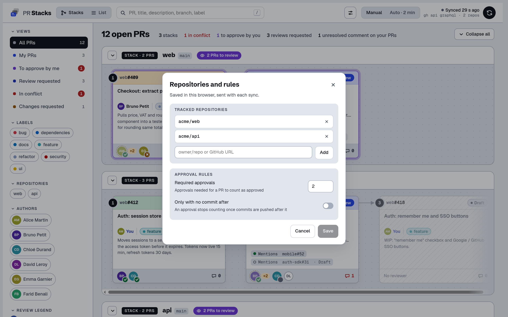

# PR Stacks

[](https://github.com/8Thomas8/pr-stacks/actions/workflows/ci.yml)


Dashboard of the open pull requests of a few GitHub repos, grouped by stack: when a PR targets the branch of another PR, it is shown on top of it. You see the merge order, who still has to review what, and which PR blocks the rest.

Nuxt 4 + Reka UI. Data comes from `gh api graphql`, run by the Nitro server, so the token stays on your machine. It only runs locally (`127.0.0.1`), with no auth.


| List view | PR details |
| --- | --- |
|  |  |



## Setup

You need Node 22.12+ and [`gh`](https://cli.github.com/) logged in with read access to the repos.

```sh
npm install
npm start                            # http://127.0.0.1:4321
```

Then open Options → Repositories and rules to add your repos (`owner/repo` or a GitHub URL), the number of approvals a PR needs, and whether an approval still counts once commits are pushed after it. These settings are saved in the browser and sent with each sync; there is no config file. On first launch the app opens on an empty state with a button to that window.

`npm start` rebuilds only when the sources changed since the last build. `npm run dev` for hot reload. Both use port 4321, change it with `PORT`.

`PR_STACKS_DEMO=1 npm run dev` serves made-up PRs (repos `acme/web` and `acme/api`) without calling `gh`: that's how the screenshots are taken.

## Notes

- Drafts are faded and left out of the "to approve" / "in conflict" counts.
- A PR counts as approved once it has the number of approvals set in Repositories and rules (only approvals with no commit after them, if that option is on). GitHub's own review rule is not used for this; "changes requested" still comes from GitHub.
- "To approve by me": PRs you reviewed that got new commits since, or where your review was requested again.
- The `+N` next to a reviewer is the number of commits pushed after their review.
- Any PR mentioned in a description (`#123`, `repo#123` for a tracked repo, `owner/repo#123` or a GitHub URL) is shown as a dependency, across repos too. Mentioned PRs that are merged, closed or outside the tracked repos come with their state: one more `gh api` call per mentioned repo, merged ones are cached.
- Descriptions are rendered as GitHub markdown in the PR details.
- Options menu: repositories and rules, language, theme, density (normal; compact keeps the sizes and drops descriptions and links; ultra compact also shrinks everything), auto sync interval (2 min by default, from 30 s to 10 min) and CI status.
- CI status is off by default: it makes each `gh api` call a lot heavier.
- Filter and detail sections fold, and stay folded across reloads.
- Shortcuts: `/` search, `R` refresh, `1` / `2` switch view, `Esc` close.
- Up to 300 open PRs per repo, fetched 20 at a time (bigger pages get 502s on large repos).

If PRs don't load, the error shown is the one from `gh`: check `gh auth status` and SSO authorization for the org.

## License

MIT
