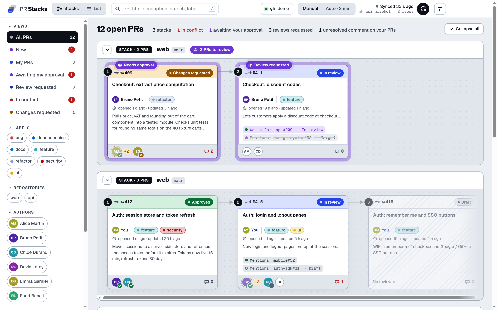
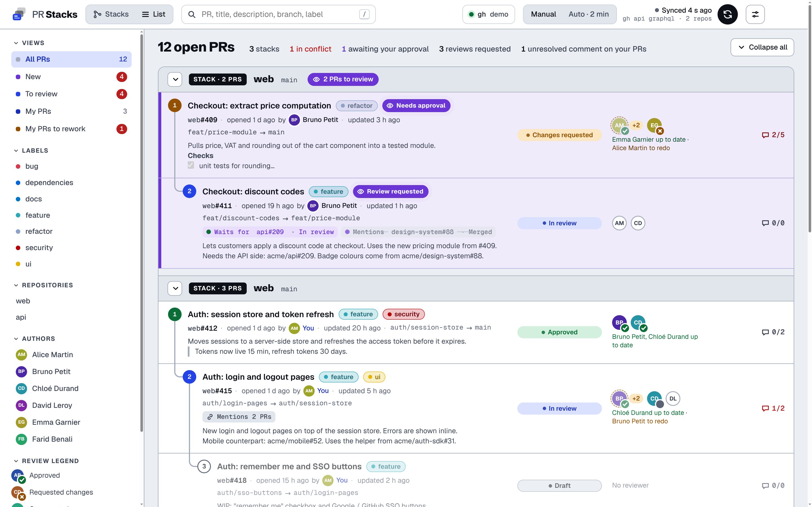
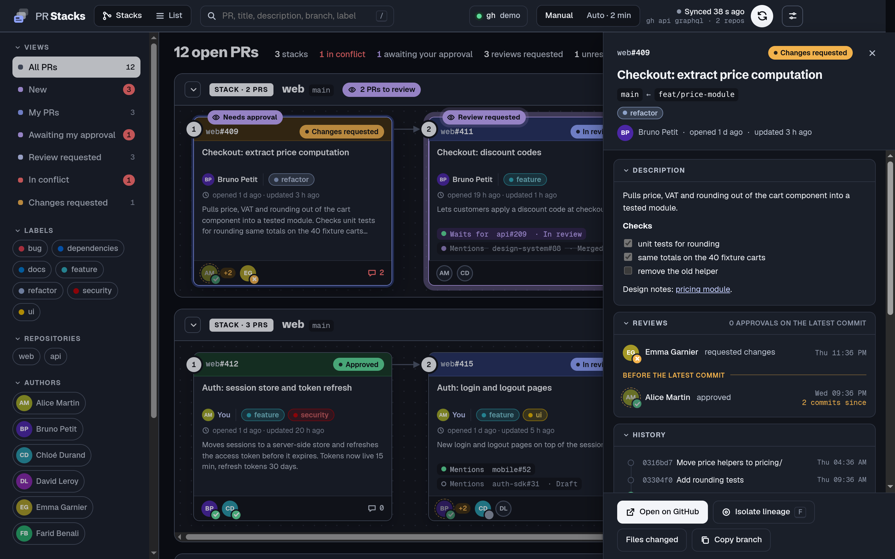
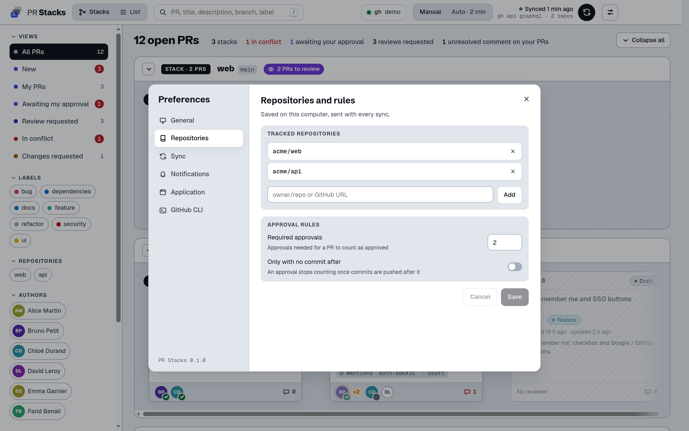

# PR Stacks

[](https://github.com/8Thomas8/pr-stacks/actions/workflows/ci.yml)
[](https://github.com/8Thomas8/pr-stacks/releases/latest)


Desktop app (Linux, Windows, macOS) showing the open pull requests of a few GitHub repos, grouped by stack: when a PR targets the branch of another PR, it is shown on top of it. You see the merge order, who still has to review what, and which PR blocks the rest.

Electron + Nuxt 4 + Reka UI. Data comes from `gh api graphql`, run in the app's main process, so the token never leaves `gh`. The Nitro server is not exposed on any port: the window talks to it through an `app://` protocol.



| List view | PR details |
| --- | --- |
|  |  |



## Install

Download the installer for your system from the [latest release](https://github.com/8Thomas8/pr-stacks/releases/latest):

| System | File |
| --- | --- |
| Windows | `.exe` installer |
| macOS | `.dmg`, `arm64` for Apple Silicon, `x64` for Intel |
| Linux | `.AppImage` (any distro) or `.deb` (Debian, Ubuntu) |

The builds are not signed yet. On Windows, SmartScreen asks to confirm ("More info" → "Run anyway"). On macOS (12+), open the app once, then System Settings → Privacy & Security → "Open Anyway" (right-click → Open is enough before macOS 15), or run `xattr -cr "/Applications/PR Stacks.app"`. The AppImage needs `libfuse2` on Ubuntu 22.04+.

You also need [`gh`](https://cli.github.com/) logged in (`gh auth login`) with read access to the repos. The `gh` badge in the toolbar shows whether it is installed and signed in, and Preferences → GitHub CLI walks you through it otherwise.

Then open Preferences → Repositories to add your repos (`owner/repo` or a GitHub URL), the number of approvals a PR needs, and whether an approval still counts once commits are pushed after it. Settings are stored on your computer and sent with each sync; there is no config file. On first launch the app opens on an empty state with a button to that tab.

## Desktop

- The toolbar is the title bar: drag it from any empty spot. On macOS the app has its regular menu bar.
- Closing the window keeps PR Stacks in the notification area (menu bar on macOS) and auto sync keeps running. Turn it off (always on for macOS), or open at login, in Preferences → Application.
- System notifications when a PR starts needing you, each kind can be turned off in Preferences → Notifications:
  - reviews: review requested, new commits to re-approve;
  - your PRs, from one sync to the next: approved, changes requested, new comments, CI failed, conflict, the PR it is stacked on merged or closed;
  - your GitHub notifications, checked every minute on every repository: mentions, PRs merged or closed, assignments, activity on repositories not tracked here. Clicking one marks it read on GitHub (can be turned off). The tray icon turns red when PRs need you (their number in its tooltip); on macOS the Dock icon shows the count.
- Links to GitHub open in your browser.

## Development

Node 22.12+.

```sh
npm install
npm run dev        # nuxt dev + Electron window, with hot reload
npm start          # production build (rebuilt only when sources changed) in Electron
npm run dist       # installers for the current OS in dist/
npm run icons      # regenerate the PNG icons from build/icon.svg and build/tray.svg
```

`PR_STACKS_DEMO=1 npm run dev` serves made-up PRs (repos `acme/web` and `acme/api`) without calling `gh`: that's how the screenshots are taken, in the Electron window at 1440×900 (×2).

### Releases

[release-please](https://github.com/googleapis/release-please) keeps a release PR open from the [conventional commits](https://www.conventionalcommits.org/) merged on `master` (version bump + `CHANGELOG.md`). Merging it creates the tag and a draft GitHub release; the Release workflow then builds the installers on Linux, Windows and macOS, attaches them and publishes the release. If one OS fails the release stays in draft: once fixed, run the Release workflow by hand with the tag. PRs are squash-merged, so their title is what release-please reads: give it a conventional prefix (`feat:`, `fix:`…). The repo setting Actions → General → "Allow GitHub Actions to create and approve pull requests" must stay on. Running it by hand with a tag also rebuilds the installers of an existing release.

## Notes

- Drafts are faded and left out of the "to approve" / "in conflict" counts.
- A PR counts as approved once it has the number of approvals set in Preferences → Repositories (only approvals with no commit after them, if that option is on). GitHub's own review rule is not used for this; "changes requested" still comes from GitHub.
- "To approve by me": PRs you reviewed that got new commits since, or where your review was requested again.
- The `+N` next to a reviewer is the number of commits pushed after their review.
- Any PR mentioned in a description (`#123`, `repo#123` for a tracked repo, `owner/repo#123` or a GitHub URL) is shown as a dependency, across repos too. Mentioned PRs that are merged, closed or outside the tracked repos come with their state: one more `gh api` call per mentioned repo, merged ones are cached.
- Descriptions are rendered as GitHub markdown in the PR details.
- Preferences (`Ctrl+,` / `⌘,`): language, theme, density (normal; compact keeps the sizes and drops descriptions and links; ultra compact also shrinks everything), repositories and rules, auto sync interval (2 min by default, from 30 s to 10 min), CI status, notifications, tray and login behaviour, GitHub CLI status.
- CI status is off by default: it makes each `gh api` call a lot heavier.
- Filter and detail sections fold, and stay folded across reloads.
- Isolate a PR's lineage (its parents down to the base branch and the PRs stacked on it) from the PR details. It stays isolated across reloads; if the PR is merged or closed, the lineage moves to the next open PR in it.
- Shortcuts: `/` search, `R` refresh, `1` / `2` switch view, `F` isolate the open PR's lineage, `Esc` close or show all PRs again. With `Ctrl` (`⌘` on macOS): `R` refresh, `F` search, `,` preferences, `1` / `2` views, `+` / `-` / `0` zoom.
- Up to 300 open PRs per repo, fetched 20 at a time (bigger pages get 502s on large repos).

If PRs don't load, the error shown is the one from `gh`: check `gh auth status` and SSO authorization for the org.

## License

MIT
